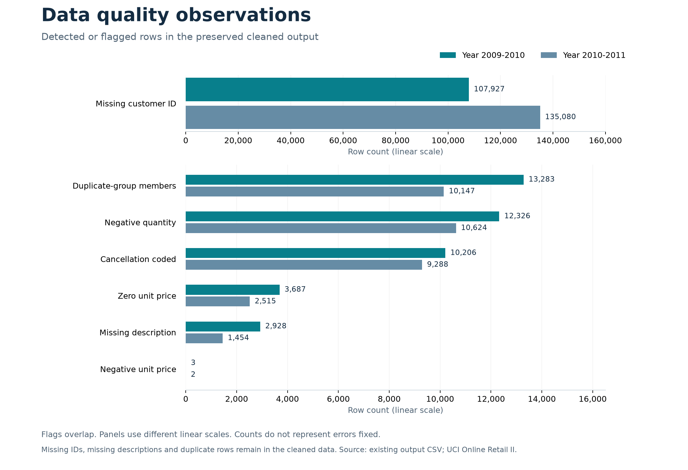

# Online Retail II: auditable data preparation

Retail transactions can contain missing customer details, repeated rows, cancellations, and signed quantities. This Python and Pandas project prepares the UCI Online Retail II workbook for analysis while preserving the original records and row lineage for review.

This is a **self-directed portfolio project using a public dataset**, not a paid client engagement. No revenue uplift, savings, or other business outcome has been measured.

## Verified results

| Check | Result |
| --- | ---: |
| Source records preserved in the cleaned output | 1,067,371 |
| Gross positive sales lines in the analysis subset | 1,041,670 |
| Records excluded only from the sales subset | 25,701 |
| Missing customer IDs retained | 243,007 |
| Missing descriptions retained | 4,382 |
| Rows flagged as members of exact duplicate groups | 23,430 |
| Recorded pytest results | 7 passed, 0 failed, 0 skipped |

The cleaned output retains every source record. The subset requires positive quantity, positive price, and a non-cancellation invoice; it represents gross positive sales lines, **not verified net revenue**. The [verification report](reports/final_verification_report.md) explains the checks and their limits.

## Quality observations



Counts describe detected or flagged records, not errors fixed. Categories overlap; the chart uses separate, labeled scales. Missing customer IDs and descriptions remain missing, and duplicate records remain in the cleaned data.

## Explore the delivery package

- [Client summary PDF](reports/client_summary.pdf): project scope, findings, preservation comparison and validation.
- [Sample workbook](portfolio/sample_cleaned_data.xlsx): 805 deterministically selected rows, with original values, flags, lineage, and Excel text identifiers. Rare statuses are overrepresented; do not use the sample for population totals.
- [Data dictionary](portfolio/data_dictionary.xlsx): all 33 output columns, types, examples and business rules.
- [Client delivery guide](portfolio/client_delivery_guide.md): file descriptions, import instructions and limitations.
- [Portfolio case study](portfolio/portfolio_case_study.md) and [artifact verification manifest](portfolio/artifact_verification.json).
- [Initial assessment](reports/initial_data_quality_report.md), [cleaning report](reports/cleaning_report.md), and [publication checklist](PUBLICATION.md).

## Project structure

```text
src/                         Inspection, cleaning and delivery-package generators
tests/                       Synthetic pytest fixtures
reports/                     Assessment reports, client PDF and quality chart
portfolio/                   Sample workbooks, guide, case study and verification manifest
data/online_retail_II.xlsx   Input workbook (obtain separately; Git-ignored)
data/processed/              Reserved for generated data (Git-ignored)
outputs/                     Full generated CSVs and temporary previews (Git-ignored)
requirements.txt             Python dependencies
```

The ignored data and output paths are for local use; they will not appear in a fresh checkout until the input is supplied and the pipeline is run. The original workbook and full CSVs are excluded from the portfolio folder and version control.

## Installation and use

Python 3.11 or newer is required by the verified dependencies. Obtain `online_retail_II.xlsx` from the [UCI dataset page](https://archive.ics.uci.edu/dataset/502/online+retail+ii) and place it in `data/`. The scripts do not download the dataset.

```powershell
python -m venv .venv
.\.venv\Scripts\Activate.ps1
python -m pip install -r requirements.txt
python src/inspect_data.py
python src/clean_data.py
python -m pytest -q
python src/build_portfolio.py
```

On macOS or Linux, activate the environment with `source .venv/bin/activate`. With the existing `.venv`, skip environment creation. Inspection and cleaning read the workbook and generate reports and CSVs; the source workbook is not overwritten. To rebuild only the portfolio package from existing CSVs and reports, run `python src/build_portfolio.py`. The cleaning script accepts `--input`, `--cleaned-output`, `--sales-output` and `--report`; the inspection script accepts `--input` and `--output`.

Regenerated inspection and cleaning reports can contain machine-specific absolute paths. Replace these with project-relative paths and review generated files before public sharing; see [PUBLICATION.md](PUBLICATION.md).

## Interpretation and limitations

- `source_worksheet`, `source_excel_row` and `source_row_id` provide row lineage; `source_*` columns retain values as read from the workbook. Invoice numbers and stock codes are handled as strings, and no customer IDs or prices are invented.
- Exact duplicates are flagged within each worksheet across source fields, including every member of a repeated group. They are not removed. Negative quantities and cancellation-coded invoices can be legitimate business events; they do not by themselves prove a refund.
- Status precedence is review for missing required values, zero quantity or negative price; then cancellation-coded invoice; then other negative quantity; then zero price; otherwise normal sale. Independent flags can overlap.
- `line_total` is the signed product of finite numeric quantity and unit price. No invoice-level netting or currency-rounding policy is applied; financial use requires business review.
- CSV has no type metadata. Import `invoice_no`, `stock_code`, `customer_id` and their source audit fields as strings; default readers can infer numeric identifiers. See the [delivery guide](portfolio/client_delivery_guide.md) for an example.
- The analysis-ready CSV filters on positive quantity and price and a non-cancellation invoice. It can include duplicates and missing optional customer information. The full cleaned CSV exceeds the row limit of a single Excel worksheet; use suitable chunked or database tooling for the full dataset.

## Dataset attribution and licensing

Chen, D. (2012). *Online Retail II* [Dataset]. UCI Machine Learning Repository. [https://doi.org/10.24432/C5CG6D](https://doi.org/10.24432/C5CG6D). The [UCI source](https://archive.ics.uci.edu/dataset/502/online+retail+ii) lists the dataset under [CC BY 4.0](https://creativecommons.org/licenses/by/4.0/). This project standardizes, annotates and samples the dataset; no endorsement is implied. The dataset license does not select a license for this project's code; choose one before publication if desired.
